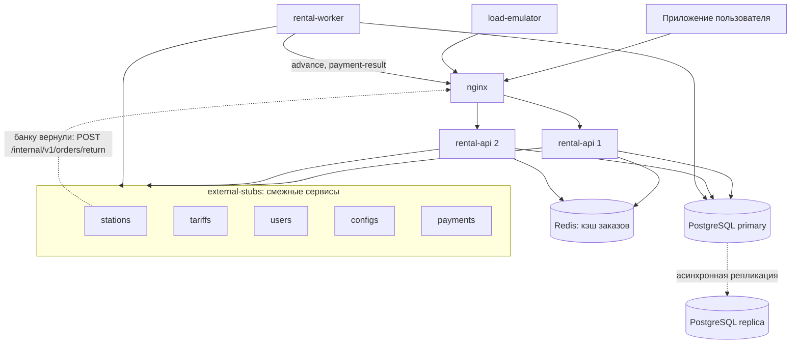
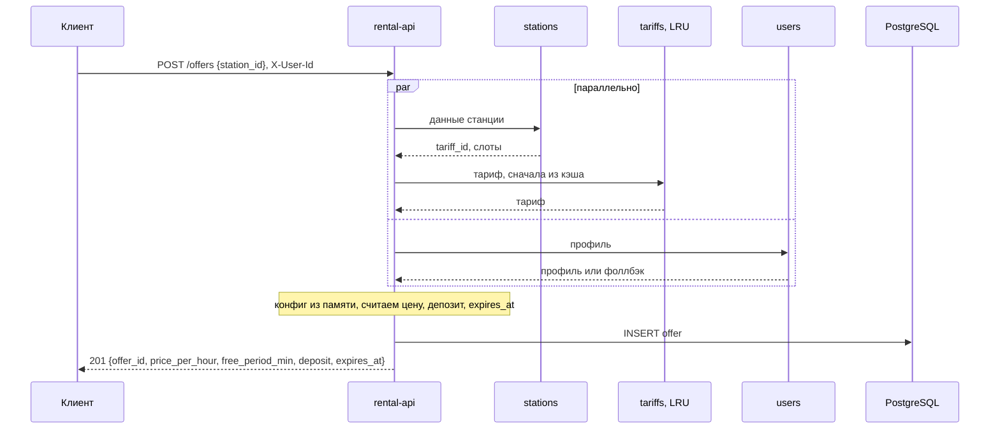
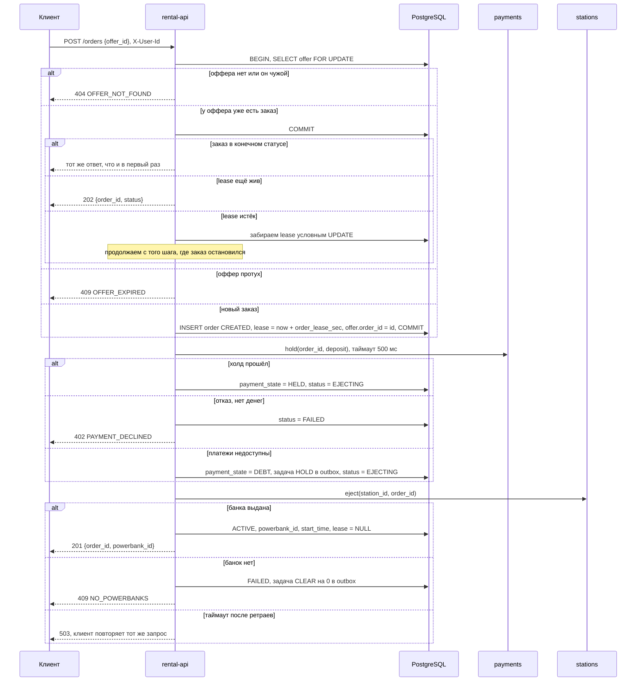
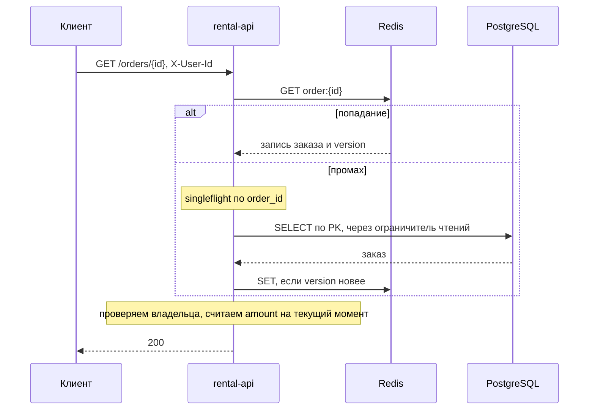
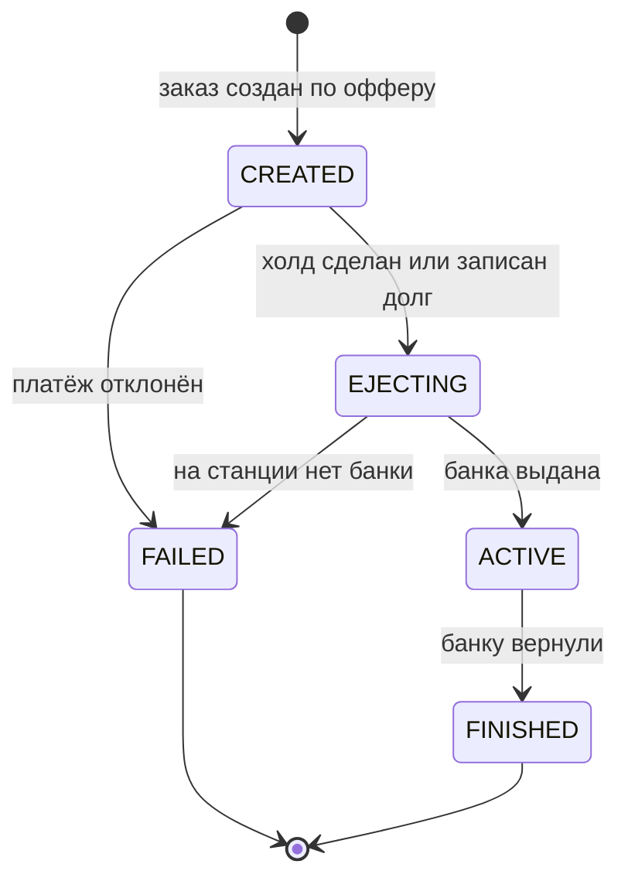

# ADR-0001. Архитектура сервиса аренды пауэрбанков

| | |
|---|---|
| Статус | Предложено, ждёт ревью (редакция 2) |
| Дата | 24.11.2026 |
| Команда | 6: Диалектов Иван, Другов Максим, Погосов Арсений, Полетаев Максим |
| Ревьюер | Степан Мацкевич |
| Заготовка | https://github.com/smatskevich/hse-sd-hw1-var2 |

## 1. Контекст

Заготовка умеет три вещи: создать оффер, начать аренду с выдачей банки и вернуть банку. Всё работает в одном процессе, данные лежат в словарях в памяти, внешние сервисы вызываются по очереди и без обработки ошибок.

Что в заготовке не так и что мы чиним:

- Нет БД. После перезапуска все аренды теряются.
- Гонка в `handle_start_order_request`. Два одинаковых запроса создадут два заказа и выдадут две банки.
- Оффер не проверяется ни на свежесть, ни на владельца.
- Внешние вызовы идут последовательно, без таймаутов, ретраев и фоллбэков. Отказ любого источника роняет запрос.
- Платежи вызываются синхронно, поэтому их отказ роняет аренду.
- Ошибки в коде: `actual_free_period` (опечатка, у подписчиков будет NameError), `duration.total_hours()` (такого метода нет), целые часы округляются вниз, `MAGIC_CONSTANT` зашит в код.
- Выдача банки не идемпотентна: заглушка станции не знает, для какого заказа выдаёт банку, и всегда отдаёт один и тот же `powerbank_id`.
- Бизнес-логика, HTTP и хранение смешаны в одном файле (нарушение SRP и DIP), поэтому её нельзя протестировать без живых сервисов.

### 1.1. Требования команды 6 (из таблицы ДЗ 1)

| Параметр | Значение |
|---|---|
| Постановка | Аренда пауэрбанка |
| X: заказы в секунду (внешняя нагрузка) | 10 RPS |
| Y: просмотров информации на одну аренду | 100 |
| Z: размер записи об аренде | 1 КБ |
| Идемпотентность | Нужна |
| Расширения | Контроль свежести оффера; ручка с информацией об аренде и текущей накопленной стоимостью |
| Критичный источник | stations |
| config | Кэш, обновляется раз в минуту |
| tariffs | LRU-кэш, данные старше 10 минут невалидны (ошибка), 10 минут задаются конфигом |
| users | Фоллбэк, жадный прайсинг |
| payments | Недоступны: навешиваем долг и пускаем в аренду |
| Хранение | 2 года (только для расчёта ресурсов) |

### 1.2. Функциональные требования (FR)

1. **Создание оффера.** По `station_id` и пользователю считаем цену в час, бесплатный период и депозит. Оффер сохраняем со сроком жизни.
2. **Начало аренды по офферу.** Проверяем владельца и свежесть оффера, холдируем депозит, выдаём банку на станции. Повтор запроса не создаёт второй заказ и не выдаёт вторую банку. Если первый запрос ещё выдаёт банку, повтор получает `202` и текущий статус.
3. **Контроль свежести.** Если оффер старше `offer_ttl_sec` (из конфига, по умолчанию 300 секунд), заказ не создаём, отвечаем `OFFER_EXPIRED`, и клиент просит новый оффер.
4. **Возврат банки.** Вызывает станция. Закрываем аренду, считаем сумму, списываем деньги. Повтор безопасен.
5. **Информация об аренде.** Статус, тариф, время начала и текущая накопленная стоимость для активной аренды, итог для завершённой.
6. **Список аренд пользователя.** Последние аренды пользователя, постранично через курсор.

Правила цены (как в заготовке, с исправлениями):

- Если свободных банок на станции не больше `last_banks_threshold` (конфиг, по умолчанию 2), цена умножается на `last_banks_increase` (конфиг, сейчас 1,5).
- У подписчика бесплатный период не меньше 30 минут.
- Для `trusted` депозит 0, иначе `default_deposit` тарифа.
- Стоимость: аренда не дольше бесплатного периода стоит 0. Иначе платится каждый начатый час по `price_per_hour`. В заготовке часы округлялись вниз, и первый час после бесплатного периода был бесплатным; это считаем ошибкой.
- Если на станции нет банок, оффер не создаём и отвечаем `NO_POWERBANKS`.
- Деньги храним и передаём целыми рублями, как в заготовке. Цена после наценки округляется вниз до рубля.

### 1.3. Нефункциональные требования (NFR)

- **Нагрузка:** расчёт в разделе 3.
- **Задержки** (p95 внутри сервиса, без сети клиента):

  | Ручка | p95 |
  |---|---|
  | Оффер | < 300 мс |
  | Начало аренды (выдача банки физическая) | < 1 с |
  | Информация об аренде | < 50 мс |
  | Список аренд | < 100 мс |
  | Возврат | < 200 мс |

- **Ошибки:** доля ошибок по нашей вине < 0,1% при номинальной нагрузке.
- **Сохранность:** заказы и платёжные операции не теряются при перезапуске любого инстанса. Всё состояние в БД, платежи через outbox. Redis хранит только кэш, его потеря не теряет данных.
- **Деградации:** поведение при отказе каждой зависимости описано в разделе 7.

## 2. Решение коротко

- Основная логика живёт в одном stateless-сервисе **rental-api**: 2 и больше инстансов за балансировщиком. Рядом работает фоновый сервис **rental-worker**. Код rental-api он не импортирует: заказы меняет только rental-api, а worker вызывает его внутренние ручки.
- Источник истины: **PostgreSQL**. В нём офферы, заказы и задания для платежей (transactional outbox).
- **Redis** — look-aside кэш для информации об аренде (1000 RPS). Записи кэша версионированы, поэтому устаревшая версия не перезаписывает свежую. При падении Redis БД защищена от амплификации: singleflight, ограничитель параллельных чтений, L1-кэш.
- Смежные сервисы (stations, tariffs, users, configs, payments) вынесены в отдельный сервис **external-stubs**. Через admin-ручку в нём можно включать отказы и задержки.
- **Идемпотентность.** Начало аренды идемпотентно по `offer_id`: из одного оффера получается не больше одного заказа. Заказ обрабатывает тот запрос, который держит lease; повтор во время обработки получает `202`, повтор после истечения lease забирает обработку себе. В станцию и платежи ходим с ключом `order_id`.
- **Платежи** вне критического пути. Если они недоступны, записываем долг и пускаем в аренду, а worker потом проводит операцию.
- **Информацию об аренде** считаем на лету из записи заказа, без внешних вызовов.

## 3. Оценка нагрузки и данных

Допущения:

- X пиковая нагрузка. Для объёма данных берём среднюю равной пиковой: это оценка сверху.
- На один заказ приходится 3 оффера: человек смотрит цену и не всегда берёт.
- Средняя аренда длится 1 час.
- Список аренд пользователь открывает в среднем один раз на аренду.

### 3.1. Входящая нагрузка

| Ручка | Формула | RPS |
|---|---|---|
| POST /offers | 3 · X | 30 |
| POST /orders | X, плюс редкие повторы | 10 |
| POST /orders/return | X | 10 |
| GET /orders/{id} | X · Y | 1000 |
| GET /orders (список) | X | 10 |
| **Итого** | | **~1060** |

Нагрузка почти вся на чтение: 1000 из 1060 RPS приходятся на просмотр аренды.

### 3.2. Исходящие вызовы

| Куда | Когда | RPS |
|---|---|---|
| stations: данные станции | на каждый оффер | 30 |
| stations: выдача банки | на каждый заказ | 10 |
| users | на каждый оффер | 30 |
| tariffs | только при промахе LRU | ≤ 30, на практике единицы в минуту |
| configs | раз в минуту с каждого инстанса | ~0,03 |
| payments | холд и списание | 20 |

### 3.3. Redis и база данных

**Redis.** Чтения 1000 в секунду, записи ~40 в секунду (write-through после каждого изменения заказа). Ключей одновременно: активные аренды X · 3600 = 36 000 и недавно завершённые с TTL 10 минут, около 6 000. При ~1 КБ на запись это ~45 МБ.

**PostgreSQL:**

| Операции | Состав | В секунду |
|---|---|---|
| Чтения при живом Redis | промахи кэша ≤ 50 (истёкший TTL, холодные ключи) + оффер при заказе 10 + заказ при возврате 10 + список 10 | ~80, все по индексу |
| Чтения при упавшем Redis | информация 1000 + остальное 30, с ограничителем из раздела 6.4 | ~1030 |
| Записи | см. ниже | ~110 |

Записи по шагам:

| Шаг | Операции | В секунду |
|---|---|---|
| Оффер | INSERT offer | 30 |
| Начало аренды | INSERT order, UPDATE offer, UPDATE после холда, UPDATE после выдачи | 40 |
| Возврат | UPDATE order, INSERT задачи CLEAR | 20 |
| Worker | UPDATE задачи, UPDATE `payment_state` | 20 |
| **Итого** | | **~110** |

Долги добавляют задачи HOLD только при недоступности платежей, в номинале их нет.

### 3.4. Объём данных за 2 года

| Что | Расчёт | Объём |
|---|---|---|
| orders | 10 · 86 400 · 730 = 630,7 млн записей · 1 КБ | ≈ 631 ГБ |
| Индексы orders | PK, offer_id, (user_id, created_at, id), (powerbank_id, finish_time) | ≈ 120 ГБ |
| payment_tasks | 20 в секунду, храним 30 дней, ~200 Б | ≈ 10 ГБ |
| offers | 30 в секунду, храним сутки, ~300 Б | ≈ 1 ГБ |
| **Итого** | | **≈ 0,76 ТБ, с репликой ≈ 1,5 ТБ** |

**Горячие данные.** Одновременно активных аренд 36 000, это около 36 МБ. Они помещаются и в Redis, и в shared_buffers PostgreSQL. Поэтому при падении Redis БД отдаёт чтения из памяти, и защищать её нужно от всплеска числа одновременных запросов и соединений, а не от чтения с диска.

**Сеть:** 1000 RPS · ~0,5 КБ ответа ≈ 0,5 МБ/с.

**Шардирование не нужно.** Около 110 записей в секунду и 0,76 ТБ за 2 года держит один узел PostgreSQL. Если нагрузка вырастет:

1. партиционируем orders по месяцам;
2. список аренд переносим на реплику;
3. шардируем по `user_id`.

### 3.5. Ресурсы

| Компонент | Ресурсы | Комментарий |
|---|---|---|
| rental-api | 2 инстанса · 2 vCPU, 1 ГБ, по 2 воркера uvicorn | ~2000 RPS суммарно: запас ×2, переживает падение одного инстанса |
| rental-worker | 1 инстанс, 0,5 vCPU | Можно запустить 2, задания разбираются через `FOR UPDATE SKIP LOCKED` |
| PostgreSQL | primary 4 vCPU, 16 ГБ RAM, SSD 1 ТБ; асинхронная реплика; бэкапы | |
| Redis | 1 инстанс, 1 vCPU, `maxmemory 256mb`, `allkeys-lru`, без персистентности | Только кэш, при потере восстанавливается из БД |
| external-stubs | 1 инстанс | |
| Prometheus + Grafana | 1 инстанс | |

## 4. Архитектура



Prometheus и Grafana собирают метрики со всех наших сервисов, на схеме их нет, чтобы не загромождать.

| Компонент | Чей | Что делает |
|---|---|---|
| rental-api | наш | Ручки и бизнес-логика. Клиенты внешних сервисов с таймаутами, ретраями и фоллбэками. Кэши tariffs и configs в памяти. Кэш заказов в Redis. |
| rental-worker | наш | Outbox платежей и сбор долгов, поиск зависших заказов, чистка старых офферов. Таблицу `orders` только читает; результаты платежей и доведение заказов передаёт в rental-api через внутренние ручки. |
| PostgreSQL | хранилище | offers, orders, payment_tasks. Источник истины. |
| Redis | кэш | Записи заказов с версией. Потеря Redis не теряет данных. |
| external-stubs | смежные | stations, tariffs, users, configs, payments. Ключи идемпотентности для выдачи и платежей, admin-ручка для отказов и задержек. |
| nginx | инфраструктура | Балансировка между инстансами rental-api. Пути `/internal/*` наружу закрыты. |
| load-emulator | тесты | Профиль нагрузки команды 6, раздел 11 |
| Prometheus + Grafana | наблюдаемость | Метрики и графики, раздел 10 |

Требование «2+ микросервиса» закрыто так:

- смежные сервисы хостятся отдельно;
- основная логика разделена на rental-api и rental-worker.

**Владение данными.** `offers` и `orders` меняет только rental-api, поэтому вся логика переходов статусов, lease, версий и записи в кэш живёт в одном месте. rental-worker разбирает `payment_tasks`, которые rental-api кладёт в той же транзакции, что и изменение заказа, и удаляет старые офферы без заказа.

### 4.1. Устройство кода (Maintainability)

Слои внутри rental-api, зависимости идут только сверху вниз:

| Слой | Что внутри |
|---|---|
| `api/` | Роутеры FastAPI и DTO запросов и ответов. Только валидация, вызов use case и перевод ошибок домена в HTTP-коды. |
| `services/` | Use case: `CreateOffer`, `StartOrder`, `ReturnPowerbank`, `GetOrderInfo`, `ListOrders` |
| `domain/` | Чистые функции без IO: расчёт цены, депозита, стоимости аренды, переходы статусов заказа. Текущее время передаётся параметром. |
| `clients/` | `StationsClient`, `TariffsClient` (LRU), `UsersClient` (фоллбэк), `ConfigProvider`, `PaymentsClient`; общий модуль с circuit breaker, ретраями и retry budget. Интерфейсы через `Protocol`, в тестах подменяются фейками. |
| `cache/` | `OrdersCache` на Redis: чтение, запись с проверкой версии, singleflight, L1 на время отказа Redis |
| `repo/` | `OffersRepo`, `OrdersRepo`, `PaymentTasksRepo` на PostgreSQL (asyncpg, SQL без ORM) |
| `worker/` | Обработчик outbox, доведение зависших заказов, чистка |

Все числа (пороги, TTL, таймауты) приходят из конфига, магических констант в коде нет.

**Конфиг** (сервис configs, обновление раз в минуту):

| Ключ | По умолчанию | Что задаёт |
|---|---|---|
| `last_banks_threshold` | 2 | Порог «последних банок» |
| `last_banks_increase` | 1,5 | Наценка на последние банки |
| `offer_ttl_sec` | 300 | Срок жизни оффера |
| `tariff_cache_ttl_sec` | 600 | Сколько тариф в кэше считается валидным |
| `order_lease_sec` | 10 | Lease на обработку заказа |
| `billing_time_scale` | 1 | Масштаб времени для расчёта стоимости. Только для нагрузочного стенда, раздел 11. |
| `subscriber_min_free_period_min` | 30 | Минимальный бесплатный период подписчика |

## 5. API

### 5.1. Общие правила

- Публичные ручки под `/api/v1`, ручки для станций под `/internal/v1`. Внутренние ручки nginx наружу не пропускает.
- Пользователь передаётся заголовком `X-User-Id`. Считаем, что его проставляет шлюз авторизации. Владельца оффера и заказа проверяем по нему.
- Чужой оффер или заказ отдаём как `404`, чтобы не раскрывать, что он существует.
- Время в ISO 8601, UTC. Деньги целыми рублями.
- `X-Request-Id`: если клиент прислал, возвращаем его же, иначе генерируем. Пишем в логи.
- Формат ошибки один на все ручки. `retryable` подсказывает клиенту, имеет ли смысл повтор:

```json
{"error": {"code": "OFFER_EXPIRED", "message": "Offer expired, request a new one", "retryable": false}}
```

### 5.2. Ручки

**`POST /api/v1/offers`** — создание оффера.

Запрос: `{"station_id": "st-1"}`. Ответ `201`:

```json
{"offer_id": "uuid", "station_id": "st-1", "price_per_hour": 75, "free_period_min": 5,
 "deposit": 300, "user_fallback": false, "expires_at": "2026-11-24T17:05:00Z"}
```

Идемпотентность не нужна: лишний оффер ничего не ломает, через сутки его удаляет worker.

**`POST /api/v1/orders`** — начало аренды. Ключ идемпотентности `offer_id`.

Запрос: `{"offer_id": "uuid"}`.

- `201`: банка выдана.

  ```json
  {"order_id": "uuid", "status": "ACTIVE", "powerbank_id": "pb-...", "start_time": "...",
   "price_per_hour": 75, "free_period_min": 5, "deposit": 300}
  ```

- `202`: заказ в `CREATED` или `EJECTING`, его обрабатывает другой запрос. Заголовки `Location: /api/v1/orders/{id}` и `Retry-After: 1`, тело `{"order_id": "uuid", "status": "EJECTING"}`. Клиент опрашивает `GET /api/v1/orders/{id}` или повторяет этот же запрос.
- Повтор по заказу в конечном статусе получает тот же код и то же тело, что и первый запрос: `201` для `ACTIVE` и `FINISHED`, исходную ошибку для `FAILED`.

**`GET /api/v1/orders/{order_id}`** — информация об аренде. Ответ `200`:

```json
{"order_id": "uuid", "status": "ACTIVE", "powerbank_id": "pb-...",
 "start_station_id": "st-1", "finish_station_id": null,
 "price_per_hour": 75, "free_period_min": 5, "deposit": 300,
 "start_time": "...", "finish_time": null, "payment_state": "HELD",
 "amount": 150, "amount_is_final": false, "calculated_at": "..."}
```

Для `ACTIVE` поле `amount` — накопленная стоимость на `calculated_at`, для `FINISHED` — итог. Заголовок `Cache-Control: no-store`.

**`GET /api/v1/orders?limit=20&status=ACTIVE&cursor=...`** — список аренд пользователя, раздел 6.6.

Ответ `200`: `{"items": [...], "next_cursor": "..."}`. Элементы в том же формате, что у информации об аренде.

**`POST /internal/v1/orders/return`** — возврат, вызывает станция.

Запрос: `{"powerbank_id": "pb-...", "station_id": "st-2"}`. Ответ `200`: `{"order_id": "uuid", "total_amount": 150, "finish_time": "..."}`.

**`POST /internal/v1/orders/{order_id}/advance`** — вызывает rental-worker для заказа с истёкшим lease. rental-api забирает lease и доводит заказ тем же кодом, что и повтор клиента. Ответ `200 {"order_id", "status"}`. Если lease кто-то держит, возвращается текущий статус без изменений.

**`POST /internal/v1/orders/{order_id}/payment-result`** — вызывает rental-worker после проведения задачи outbox. Запрос: `{"kind": "HOLD" | "CLEAR", "result": "success" | "declined"}`. rental-api меняет `payment_state` (`HELD` или `CLEARED`), увеличивает `version` и пишет заказ в кэш. Повтор безопасен, ответ `204`.

**Служебные:**

- `GET /health/live` — процесс жив.
- `GET /health/ready` — есть соединение с PostgreSQL и конфиг загружен, хотя бы из дефолтов. Redis в readiness не входит: без него сервис работает в деградированном режиме.
- `GET /metrics`.

### 5.3. Коды ошибок

| Ручка | Код | `code` | `retryable` |
|---|---|---|---|
| все | 400 | `VALIDATION_ERROR` | нет |
| все | 503 | `DB_UNAVAILABLE` | да |
| offers | 409 | `NO_POWERBANKS` | нет |
| offers, orders | 503 | `STATIONS_UNAVAILABLE` | да |
| offers | 503 | `TARIFF_UNAVAILABLE` | да |
| orders | 404 | `OFFER_NOT_FOUND` (нет, удалён или чужой) | нет |
| orders | 409 | `OFFER_EXPIRED` | нет |
| orders | 402 | `PAYMENT_DECLINED` | нет |
| orders | 409 | `NO_POWERBANKS` | нет |
| orders/{id} | 404 | `ORDER_NOT_FOUND` (нет или чужой) | нет |
| orders/{id}, список | 503 | `OVERLOADED`, с `Retry-After` | да |
| список | 400 | `INVALID_CURSOR` | нет |
| return | 404 | `ORDER_NOT_FOUND` | нет |

### 5.4. Контракт смежных сервисов (external-stubs)

Заготовку заглушек меняем так, чтобы она была похожа на настоящие сервисы:

| Ручка | Изменение |
|---|---|
| `POST /eject-powerbank {station_id, order_id}` | Вместо `GET` только со `station_id`. Идемпотентна по `order_id`: повтор отдаёт тот же результат. Выдаёт уникальный `powerbank_id`. |
| `POST /hold-money-for-order`, `POST /clear-money-for-order` | Идемпотентны по `(order_id, тип операции)`. Отвечают `{"status": "success"}` или `{"status": "declined"}`. |
| `GET /configs` | Добавлены ключи из раздела 4.1. |
| `GET /user-profile` | Поле `has_subscription` вместо `has_subscribtion` с опечаткой. |
| `POST /stations/return {powerbank_id, station_id}` | Для эмулятора: заглушка станции «принимает» банку и сама вызывает `/internal/v1/orders/return`, как сделала бы настоящая станция. |
| `POST /admin/faults {service, mode, latency_ms, error_rate}` | Включает отказы: `mode` один из `ok`, `error`, `timeout`, `slow`. |
| `GET /admin/payments/summary` | Сумма проведённых списаний для сверки после прогона. |

## 6. Сценарии

### 6.1. Создание оффера



Станция и профиль запрашиваются параллельно. Тариф зависит от `tariff_id` станции и обычно берётся из кэша, поэтому задержка примерно равна одному вызову станции.

### 6.2. Начало аренды

Заказ создаётся в короткой транзакции. Станцию и платежи ждём вне транзакции, чтобы не держать блокировку и соединение с БД секундами. Обработкой заказа владеет тот, кто держит **lease**: `orders.processing_until`.



После каждого коммита, изменившего заказ, новая версия записывается в кэш (раздел 6.4).

**Lease:**

- `order_lease_sec` = 10 секунд. Это больше бюджета одной попытки обработки: холд до 1 с, выдача до 6,2 с (раздел 7.2).
- Забрать lease: `UPDATE orders SET processing_until = now() + lease WHERE id = $1 AND status IN ('CREATED', 'EJECTING') AND processing_until < now() RETURNING *`. Это делает только один запрос.
- Каждый переход статуса — условный `UPDATE ... WHERE status = <ожидаемый>`. Поэтому, даже если старый обработчик ещё жив после истечения lease, двойного перехода не будет. Внешние вызовы идут с ключом `order_id` и тоже не задваиваются. Lease только убирает лишнюю работу и даёт клиенту понятный `202`.
- Если клиент не повторил запрос, заказ с истёкшим lease находит worker и вызывает `advance`. Дальше работает тот же код rental-api, что и при повторе клиента.

### 6.3. Возврат банки

Станция вызывает `POST /internal/v1/orders/return {powerbank_id, station_id}`. Всё делается в одной транзакции:

1. Находим заказ: `SELECT ... WHERE powerbank_id = $1 AND status = 'ACTIVE' FOR UPDATE`.
2. Считаем сумму и ставим `FINISHED`, `finish_time`, `finish_station_id`, `total_amount`, `version = version + 1`.
3. Кладём задачу `CLEAR(total_amount)` в `payment_tasks`.

После коммита пишем новую версию в кэш. Списание делает worker. Возврат не зависит от доступности платежей.

### 6.4. Информация об аренде и кэш



**Что лежит в кэше.** Ключ `order:{id}`: запись заказа и её `version`, TTL 10 минут. Стоимость не кэшируем, она считается на лету.

**Как не получить устаревший кэш.** Возможна такая гонка: медленный читатель берёт из БД заказ в `ACTIVE`, параллельно проходит возврат, а затем читатель кладёт в кэш старую запись. После этого пользователь видел бы «аренда идёт» уже после возврата. Чтобы этого не было:

- в `orders` колонка `version`, она растёт при каждом изменении заказа;
- в Redis пишем Lua-скриптом, который записывает значение, только если его `version` больше уже лежащей;
- после каждого коммита, изменившего заказ, сразу пишем новую версию (write-through), а не удаляем ключ. Заказы меняет только rental-api, поэтому это правило соблюдается в одном месте.

В итоге пользователь видит свои изменения сразу (read-your-writes).

**Если write-through не прошёл** (Redis моргнул), повторяем запись в фоне до 30 секунд. Если инстанс упал в это окно, кэш может показывать старую версию до истечения TTL. Риск принимаем, он описан в разделе 12.

**Защита БД от амплификации при отказе Redis.** Когда Redis падает или перезапускается пустым, все 1000 RPS чтений разом уходят в PostgreSQL. Защита:

- **Circuit breaker на Redis.** При открытом breaker в Redis не ходим и не тратим время на таймауты.
- **Singleflight по `order_id`** в каждом процессе. Одновременные промахи по одному заказу дают один запрос в БД, остальные ждут его результат.
- **Ограничитель параллельных чтений.** Отдельный пул соединений для `GET /orders/{id}` и списка: 8 соединений на процесс uvicorn. Запрос ждёт свободное соединение не дольше 50 мс, затем получает `503 OVERLOADED` с `Retry-After: 1`. Офферы, заказы и возвраты идут через основной пул и не голодают.
- **L1-кэш в памяти процесса на 2 секунды.** Работает только пока breaker Redis открыт. В нормальном режиме L1 выключен, потому что он нарушил бы read-your-writes между инстансами.

Таймаут на Redis 20 мс, без ретраев.

### 6.5. Статусы заказа



Платёжное состояние заказа хранится отдельно: `NONE → HELD | DEBT → CLEARED`. `DEBT` означает, что холд не прошёл из-за недоступности платежей и worker ещё не провёл операцию.

### 6.6. Список аренд и курсор

- Порядок `created_at DESC, id DESC`. Пагинация по ключу (keyset), без `OFFSET`: `WHERE user_id = $1 AND (created_at, id) < ($2, $3) ORDER BY created_at DESC, id DESC LIMIT $4`. Индекс `orders_user`.
- `limit` от 1 до 100, по умолчанию 20. Фильтр `status` необязательный.
- Курсор непрозрачный: `base64(created_at, id, user_id, фильтры, issued_at)` и HMAC-подпись. Ключ подписи из переменной окружения.
- Курсор действителен для того же пользователя и тех же фильтров, не дольше суток. Права проверяются на каждом запросе. При неверной подписи, чужом пользователе, других фильтрах или истёкшем сроке отвечаем `400 INVALID_CURSOR`.
- Конец списка: в ответе нет `next_cursor`.
- Читаем с primary через ограничитель чтений из раздела 6.4.

### 6.7. Идемпотентность

- **POST /orders: ключ `offer_id`.**
  - В транзакции берём оффер с блокировкой. Если у него уже есть `order_id`, работаем с этим заказом по правилам раздела 6.2: конечный статус отдаём как есть, при живом lease отвечаем `202`, при истёкшем забираем lease и продолжаем.
  - Второй параллельный запрос ждёт блокировку оффера (миллисекунды, пока идёт INSERT) и попадает в эту же ветку.
  - `UNIQUE (orders.offer_id)` страхует на уровне БД.
- **Порядок проверок.** Сначала «заказ уже есть», потом «оффер протух». Иначе повтор клиента после истечения TTL получил бы ошибку, хотя банка уже выдана.
- **Внешние вызовы с ключом.** `stations.eject(station_id, order_id)` и `payments.hold/clear(order_id)` получают `order_id` как ключ идемпотентности. Заглушки хранят результат по ключу и на повтор отвечают тем же. Поэтому ретраи и перехват lease безопасны.
- **POST /internal/v1/orders/return.**
  - Если активного заказа с этой банкой нет, но есть завершённый не больше часа назад на той же станции, отвечаем его результатом.
  - Иначе отвечаем 404, а событие пишем в лог для разбора.
- **payment_tasks.** `UNIQUE (order_id, kind)`: одна операция каждого типа на заказ.

## 7. Деградации и надёжность

### 7.1. Отказ зависимостей

| Зависимость | Критичность | Поведение при отказе | Что видит пользователь |
|---|---|---|---|
| stations | критична | Оффер: 503. Выдача: ретрай с тем же `order_id`, затем 503; клиент повторяет запрос, заказ с истёкшим lease доводит повтор или worker. | «Станция недоступна, попробуйте позже» |
| tariffs | некритична | Look-aside LRU-кэш (готовый `cachetools.LRUCache` на 10 000 записей), у записи храним время загрузки. Запись младше `tariff_cache_ttl_sec` (600 с, из конфига) берём из кэша. Старую или отсутствующую запрашиваем в сервисе. Если сервис не ответил, а записи нет или она старше 10 минут, отвечаем 503 `TARIFF_UNAVAILABLE`. | Пока кэш свежий, ничего не замечает |
| users | некритична | Фоллбэк и жадный прайсинг: `has_subscription = false`, `trusted = false`. Полный депозит, без расширенного бесплатного периода. В оффере ставим флаг `user_fallback`. | Оффер дороже, но аренда работает |
| configs | некритична | Фоновое обновление раз в 60 секунд, в работе последние успешно полученные значения. Если сервис недоступен на старте, стартуем с дефолтами из `config.defaults.json` и пишем предупреждение. Требования команды 6 этот случай не задают; сервис без конфига, но с разумными дефолтами полезнее упавшего. Метрика `config_age_seconds`. | Ничего |
| payments | некритична | Холд не прошёл из-за недоступности (таймаут, 5xx, открыт circuit breaker): `payment_state = DEBT`, задача в outbox, банку выдаём. Списание при возврате всегда идёт через outbox. Отказ «нет денег» считаем ответом, а не недоступностью: аренду не начинаем, отвечаем `402`. | Аренда работает, долг закроется позже |
| Redis | наша, некритична | Читаем из БД с защитой из раздела 6.4. Write-through пропускаем при открытом breaker. После восстановления кэш прогревается промахами, тоже через singleflight и ограничитель. | Чтения медленнее, при перегрузке редкие 503 с `Retry-After` |
| PostgreSQL | наша, критична | 503 на всех ручках. Асинхронная реплика для переключения и бэкапы. | Сервис недоступен |

### 7.2. Таймауты и ретраи

| Вызов | Таймаут | Ретраи | Circuit breaker |
|---|---|---|---|
| stations: данные станции | 300 мс | 2, задержка 50 и 100 мс с jitter | да |
| stations: выдача | 3 с | 1, тот же `order_id`, задержка 200 мс | да |
| tariffs | 200 мс | 1 | да |
| users | 200 мс | нет, сразу фоллбэк | да, при открытом сразу фоллбэк |
| configs | 1 с | в фоне каждые 60 с | нет |
| payments: холд в запросе | 500 мс | 1 | да, при открытом сразу долг |
| payments: worker | 2 с | экспоненциальная задержка до 10 минут | нет |
| Redis | 20 мс | нет | да, при открытом сразу БД |

**Защита от шторма ретраев:**

- Retry budget: ретраев не больше 10% от потока к зависимости.
- Экспоненциальная задержка с jitter.
- Circuit breaker на каждый клиент: при 50% ошибок за 10 секунд он открывается на 5 секунд, потом пропускает пробные запросы.

**Worker:**

- Задачи outbox разбирает пачками по 100 через `SELECT ... FOR UPDATE SKIP LOCKED`.
- Для каждой задачи: вызов payments с ключом `order_id`, затем `payment-result` в rental-api, затем задача помечается `DONE`. Если rental-api не ответил, задача остаётся `PENDING` и повторяется: payments идемпотентны по ключу, `payment-result` тоже.
- Задачи одного заказа выполняются по порядку: HOLD, потом CLEAR. Если к моменту CLEAR холд так и не прошёл, HOLD закрываем, а CLEAR списывает итоговую сумму напрямую.
- Заказы в `CREATED` или `EJECTING` с lease, истёкшим больше минуты назад, worker находит запросом к `orders` и для каждого вызывает `advance`.

## 8. Хранилище

**Модель согласованности.** Тип БД: реляционная. Нужна строгая согласованность (ACID): здесь деньги и физическая выдача банок. Redis не источник истины: в нём копия записи заказа с версией.

**Чтение.** На промахе кэша информацию об аренде читаем с primary. Вместе с версионированным write-through это даёт read-your-writes: сразу после возврата пользователь видит итог, а не «аренда идёт».

```sql
CREATE TABLE offers (
    id              uuid PRIMARY KEY,
    user_id         text        NOT NULL,
    station_id      text        NOT NULL,
    tariff_id       text        NOT NULL,
    price_per_hour  int         NOT NULL,
    free_period_min int         NOT NULL,
    deposit         int         NOT NULL,
    user_fallback   bool        NOT NULL DEFAULT false,
    created_at      timestamptz NOT NULL,
    expires_at      timestamptz NOT NULL,
    order_id        uuid        NULL          -- заказ, созданный по офферу
);

CREATE TABLE orders (
    id                uuid        PRIMARY KEY,
    offer_id          uuid        NOT NULL UNIQUE,
    user_id           text        NOT NULL,
    start_station_id  text        NOT NULL,
    finish_station_id text        NULL,
    powerbank_id      text        NULL,
    price_per_hour    int         NOT NULL,
    free_period_min   int         NOT NULL,
    deposit           int         NOT NULL,
    status            text        NOT NULL,   -- CREATED, EJECTING, ACTIVE, FINISHED, FAILED
    payment_state     text        NOT NULL,   -- NONE, HELD, DEBT, CLEARED
    failure_code      text        NULL,       -- PAYMENT_DECLINED, NO_POWERBANKS: для повтора с тем же ответом
    total_amount      int         NULL,
    processing_until  timestamptz NULL,       -- lease на обработку, NULL в конечных статусах
    version           int         NOT NULL DEFAULT 1,
    created_at        timestamptz NOT NULL,
    start_time        timestamptz NULL,
    finish_time       timestamptz NULL
);
CREATE UNIQUE INDEX orders_active_powerbank ON orders (powerbank_id) WHERE status = 'ACTIVE';
CREATE INDEX orders_powerbank ON orders (powerbank_id, finish_time DESC);
CREATE INDEX orders_user ON orders (user_id, created_at DESC, id DESC);
CREATE INDEX orders_stuck ON orders (processing_until) WHERE status IN ('CREATED', 'EJECTING');

CREATE TABLE payment_tasks (
    id              bigserial   PRIMARY KEY,
    order_id        uuid        NOT NULL,
    user_id         text        NOT NULL,
    kind            text        NOT NULL,     -- HOLD, CLEAR
    amount          int         NOT NULL,
    status          text        NOT NULL,     -- PENDING, DONE, FAILED
    attempts        int         NOT NULL DEFAULT 0,
    next_attempt_at timestamptz NOT NULL,
    created_at      timestamptz NOT NULL,
    UNIQUE (order_id, kind)
);
CREATE INDEX payment_tasks_pending ON payment_tasks (next_attempt_at) WHERE status = 'PENDING';
```

**Инварианты:**

- `orders_active_powerbank`: одна банка не может быть в двух активных арендах.
- `UNIQUE (offer_id)`: один оффер даёт не больше одного заказа.
- Каждое изменение заказа увеличивает `version` на 1.

**Сроки хранения:**

- Офферы старше суток worker удаляет.
- Заказы храним 2 года. По требованиям это влияет только на расчёт ресурсов, поэтому чистку заказов не делаем.

## 9. Рассмотренные альтернативы

| Вопрос | Выбрали | Рассматривали | Почему |
|---|---|---|---|
| Тип БД | Реляционная, PostgreSQL | Документная (MongoDB), wide-column (Cassandra), только Redis | Деньги и выдача банок: нужны транзакции и уникальные ограничения для идемпотентности. Объём 0,76 ТБ и ~110 записей в секунду держит один узел. |
| Где хранить оффер | Строка в БД с `expires_at` | Подписанный токен (HMAC) без хранения; Redis с TTL | Токен не защищает от повторного использования без записи в БД. Redis не даёт общей транзакции с заказом. |
| Платежи | Синхронный холд с коротким таймаутом; при недоступности долг и outbox | Всё асинхронно через очередь (Kafka); строго синхронно | Если всё асинхронно, отказ «нет денег» узнаем только после выдачи банки. Строго синхронно нарушает NFR: платежи у нас некритичны. Kafka при 20 RPS избыточна, а outbox в той же БД даёт атомарность с заказом. |
| Чтение информации, 1000 RPS | Redis look-aside с версиями и защитой от амплификации | Только PostgreSQL primary; чтение с реплики | PostgreSQL выдержит 1000 чтений по ключу, но тогда 90% нагрузки на primary — чтения, и запас по записи при росте X съедается. Кэш снимает их с primary. Реплика отстаёт и после возврата может показать «аренда идёт». Цена кэша — инвалидация и амплификация при его отказе; обе проблемы решены в разделе 6.4. |
| Инвалидация кэша | Write-through с проверкой версии в Lua | Удаление ключа после коммита и короткий TTL | При удалении ключа медленный читатель может положить в кэш старую версию после возврата. Проверка версии исключает эту гонку. |
| Повтор во время выдачи | `202` и lease на обработку | Повтор ждёт первый запрос на блокировке оффера | Ожидание держит транзакцию и соединение с БД на время выдачи (до секунд) и не решает случай, когда первый инстанс упал. Lease позволяет повтору забрать брошенный заказ. |
| Деление на сервисы | Один сервис основной логики, worker и отдельный сервис смежных систем | Отдельные offer-service и order-service | У оффера и заказа общие данные и общая транзакция (один оффер даёт один заказ). Разделение потребует распределённой транзакции при ~50 записях в секунду. |
| Язык | Python и FastAPI (async) | Go | Заготовка на Python, команда его знает. 1060 RPS держат 4 воркера uvicorn с запасом, а большая часть чтений обслуживается из Redis. |
| Ключ идемпотентности | `offer_id` как естественный ключ | Заголовок `Idempotency-Key` и таблица ключей | Оффер и так одноразовый, отдельная таблица не нужна. |
| Пагинация списка | Курсор, keyset | `OFFSET` и `LIMIT` | `OFFSET` медленнее на дальних страницах и пропускает или дублирует записи, когда появляются новые аренды. |
| Чужой оффер или заказ | `404` | `403` | `403` раскрывает, что объект с таким id существует. |
| Сжатое время в эмуляторе | `billing_time_scale` в конфиге | Фейковые часы для всего стенда; тариф с `free_period_min = 0` | Часы нельзя синхронно сдвигать в нескольких процессах. Нулевой бесплатный период не проверяет ни бесплатные аренды, ни многочасовые. |

## 10. Наблюдаемость

**Метрики** (Prometheus):

| Метрика | Что показывает |
|---|---|
| `http_requests_total{handle, code}` | Входящие запросы по ручкам и кодам ответа |
| `http_request_duration_seconds{handle}` | Задержки, гистограмма для p50, p95 и p99 |
| `dependency_requests_total{dep, result}` | Вызовы зависимостей, где `result` один из ok, error, timeout, circuit_open |
| `dependency_duration_seconds{dep}` | Задержки зависимостей |
| `users_fallback_total` | Сколько раз сработал фоллбэк профиля |
| `tariff_cache_total{result}` | Кэш тарифов: hit, miss, stale_error |
| `config_age_seconds` | Возраст последнего успешно полученного конфига |
| `order_cache_total{result}` | Кэш заказов: hit, miss, error, l1_hit |
| `order_cache_write_total{result}` | Write-through: written, stale_skipped, error |
| `singleflight_shared_total` | Сколько запросов получили результат чужого запроса в БД |
| `db_read_limiter_rejected_total` | Отказы `503 OVERLOADED` ограничителя чтений |
| `orders_total{status}` | Заказы по статусам |
| `orders_in_progress_responses_total` | Ответы `202` |
| `orders_lease_takeover_total{by}` | Перехваты lease: повтором клиента или worker |
| `payment_debt_open` | Открытые долги |
| `outbox_pending` | Задачи в очереди outbox |
| `outbox_oldest_age_seconds` | Возраст самой старой задачи outbox |
| `db_pool_in_use{pool}` | Занятые соединения основного пула и пула чтений |

**Логи:** JSON, в каждой строке `request_id`, а также `order_id` и `offer_id`, если они есть.

**Grafana:** один дашборд, на нём RPS и p95 по ручкам, ошибки, фоллбэки и долги, outbox, hit rate кэша заказов, нагрузка на БД.

## 11. Тестирование и эмулятор нагрузки

**Unit-тесты.** Расчёт цены, депозита, стоимости аренды (границы бесплатного периода, начатый час, масштаб времени), переходы статусов. Время передаётся в чистые функции параметром.

**Интеграционные тесты** (docker-compose):

- 10 параллельных одинаковых `POST /orders` дают 1 заказ и 1 выдачу; часть ответов `202`, остальные `201`.
- Обработчик заказа «умирает» после холда: повтор после истечения lease доводит заказ до `ACTIVE` без второго холда и второй выдачи.
- Повтор возврата не меняет сумму.
- Протухший оффер возвращает `OFFER_EXPIRED`.
- Повтор по уже созданному заказу после TTL оффера возвращает этот заказ.
- Сразу после возврата `GET /orders/{id}` показывает `FINISHED` на любом инстансе.
- Курсор: обход всех страниц без пропусков и дублей; чужой и изменённый курсор дают `INVALID_CURSOR`.

**Эмулятор** (locust, `FastHttpUser`, 4 процесса, чтобы узким местом был сервис, а не генератор нагрузки):

- **Сценарий пользователя.** Оффер, с вероятностью 1/3 заказ, затем просмотры аренды и список, затем возврат через ручку заглушки станции.
- **Сжатое время.** Средняя аренда длится 60 секунд вместо часа, при X = 10 одновременно идёт ~600 аренд. Каждая аренда делает 100 просмотров, равномерно по своей длительности, это те же 1000 RPS.
- **Масштаб тарификации.** В стенде `billing_time_scale = 60`: 60 секунд реального времени тарифицируются как час. Иначе бесплатный период (5 минут) длиннее любой аренды, все аренды бесплатные, и списание денег под нагрузкой не проверяется. Масштаб влияет только на расчёт стоимости. Срок жизни оффера, lease и таймауты идут в реальном времени.
- **Длительности аренд**, среднее около 60 секунд:

  | Доля | Реальная длительность | Модельная | Что проверяет |
  |---|---|---|---|
  | ~15% | до 5 с | до 5 мин | бесплатный период |
  | ~60% | 20–100 с | 20 мин – 1 ч 40 мин | первый и второй начатый час |
  | ~25% | 100–180 с | 1 ч 40 мин – 3 ч | многочасовые аренды |

- **Проверки корректности под нагрузкой:**
  1. Сумма каждой аренды совпадает с ожидаемой, которую эмулятор считает по своей измеренной длительности. Если длительность попала в окно ±1 с около границы часа, засчитываем оба соседних значения.
  2. После прогона и разбора outbox сумма списаний в заглушке payments равна сумме `total_amount` по завершённым заказам в БД.
  3. Часть клиентов (5%) шлёт `POST /orders` дважды параллельно. На каждый оффер выдана ровно одна банка: считаем по журналу выдач заглушки станции.
- **Профили нагрузки:**
  1. номинал: 30 / 10 / 1000 / 10 / 10 RPS, 15 минут;
  2. ×2 от номинала, чтобы проверить запас.

**Отказы под нагрузкой** (через admin-ручку заглушек и остановку контейнеров):

| Отказ | Ожидаем |
|---|---|
| users | Растёт `users_fallback_total`, ошибок нет |
| tariffs на 5 минут | Работаем из кэша |
| tariffs на 11 минут | Растёт `stale_error` |
| payments | Растут долги, после восстановления outbox их разбирает, сверка денег сходится |
| configs | Работаем на последнем конфиге |
| stations | 503 на офферах и выдаче, после восстановления зависшие заказы доводятся |
| Убить один инстанс rental-api | Ошибки только у запросов в полёте, заказы с брошенным lease доводятся |

**Амплификация при отказе Redis.** Три прогона на номинале, на 5-й минуте Redis останавливается, на 10-й поднимается пустым:

1. Redis не трогаем: базовая линия.
2. Redis останавливается, защита выключена флагом: ожидаем рост соединений и задержек БД, деградацию всех ручек, включая офферы и заказы.
3. Redis останавливается, защита включена: чтения БД ограничены пулом, офферы и заказы укладываются в NFR, часть просмотров получает `503 OVERLOADED` или ответ из L1.

Чтобы эффект был виден на нашей небольшой нагрузке, в стенде PostgreSQL ограничен по CPU. Это ограничение одинаково во всех трёх прогонах и описано в отчёте.

**Отчёт о тестировании:** графики из Grafana по каждому прогону и таблица «ожидали / получили», результаты трёх проверок корректности.

## 12. Последствия

**Плюсы:**

- Переживаем перезапуск инстансов, повторы запросов и отказы users, tariffs, configs, payments и Redis.
- Брошенный посреди выдачи заказ доводится без двойной выдачи и двойного холда.
- Основная нагрузка на чтение снята с primary, а отказ кэша не роняет БД.
- Запас по нагрузке ×2, масштабирование добавлением инстансов rental-api.

**Минусы и риски:**

- stations критичен: без него нет ни офферов, ни выдачи (так задано требованиями).
- Долги могут не собраться. Это риск бизнеса, принят по требованиям.
- Один primary PostgreSQL: при его отказе сервис недоступен до переключения на реплику.
- Redis — ещё один компонент в эксплуатации. Если инстанс упал между коммитом и успешным write-through, кэш может до 10 минут показывать предыдущую версию заказа.
- `billing_time_scale` — параметр для тестового стенда в рабочем конфиге. По умолчанию 1, на проде не меняется.
- Python на одном ядре даёт меньше RPS, чем Go. Компенсируем числом инстансов.
